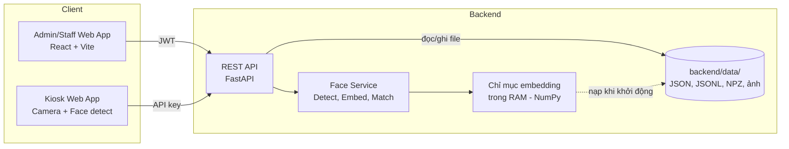
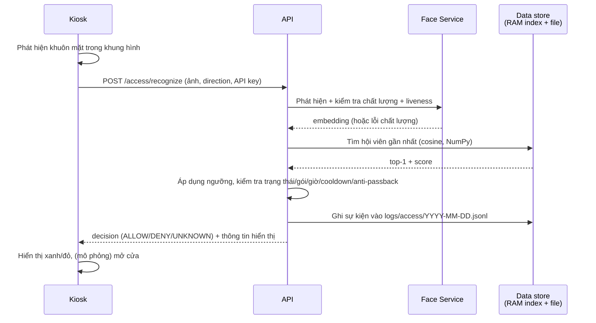

# SPEC: Hệ thống Quản lý Hội viên & Kiểm soát Ra vào bằng Nhận diện Khuôn mặt

> **Phiên bản:** 0.1 (Demo / PoC)
> **Trạng thái:** Draft
> **Mục đích:** Đặc tả yêu cầu và thiết kế kỹ thuật cho bản demo. Không nhằm triển khai production.

---

## 1. Tổng quan

### 1.1 Mục tiêu
Xây dựng một hệ thống demo gồm hai phần chính:

1. **Quản lý hội viên:** đăng ký, cập nhật, gia hạn, khóa/mở khóa hội viên, quản lý gói thành viên.
2. **Kiểm soát ra vào:** nhận diện khuôn mặt hội viên qua camera tại cửa (kiosk), tự động quyết định cho phép hoặc từ chối vào/ra, và ghi nhật ký.

### 1.2 Bối cảnh sử dụng
Phòng gym, câu lạc bộ, co-working space hoặc tòa nhà văn phòng nhỏ, nơi hội viên cần được xác thực nhanh, không cần thẻ từ.

### 1.3 Phạm vi demo
- Một cửa (một kiosk), mô phỏng cả chiều **vào** và **ra** (chọn chế độ hoặc dùng 2 camera/2 tab trình duyệt).
- Một vai trò quản trị (Admin) và một vai trò lễ tân (Staff).
- Mở cửa được **mô phỏng** bằng đèn xanh/đỏ trên màn hình (tùy chọn: relay/ESP32 ở giai đoạn mở rộng).
- **Không dùng cơ sở dữ liệu:** toàn bộ dữ liệu lưu dưới dạng file trong thư mục `backend/data/` (xem mục 6).

### 1.4 Ngoài phạm vi (Out of scope)
- Thanh toán trực tuyến, xuất hóa đơn.
- Ứng dụng di động cho hội viên.
- Đa chi nhánh, đa tenant.
- Chống giả mạo cấp độ cao (3D mask, deepfake).
- Tích hợp phần cứng khóa cửa thật.
- Cơ sở dữ liệu (PostgreSQL, SQLite...): thay bằng lưu trữ file ở giai đoạn demo.

---

## 2. Đối tượng người dùng

| Vai trò | Mô tả | Quyền chính |
|---|---|---|
| **Admin** | Quản trị hệ thống | Toàn quyền: quản lý người dùng hệ thống, gói thành viên, hội viên, cấu hình, xem log, xóa dữ liệu sinh trắc |
| **Staff** | Lễ tân | Đăng ký/sửa hội viên, gia hạn, chụp khuôn mặt, xem log, mở cửa thủ công |
| **Member** | Hội viên | Không đăng nhập hệ thống; chỉ tương tác qua camera tại cửa |
| **Kiosk** | Thiết bị cửa | Gọi API nhận diện bằng API key riêng, không có quyền quản trị |

---

## 3. Yêu cầu chức năng

### 3.1 Quản lý hội viên (Member Management)

| ID | Yêu cầu | Ưu tiên |
|---|---|---|
| FR-M01 | Tạo hội viên mới: họ tên, SĐT, email, ngày sinh, giới tính, ảnh đại diện, ghi chú | Must |
| FR-M02 | Sinh mã hội viên tự động, duy nhất (ví dụ `MB-000123`) | Must |
| FR-M03 | Xem danh sách hội viên, tìm kiếm theo tên/SĐT/mã, lọc theo trạng thái, phân trang | Must |
| FR-M04 | Xem chi tiết, chỉnh sửa, vô hiệu hóa (soft delete) hội viên | Must |
| FR-M05 | Gán gói thành viên (membership plan) với ngày bắt đầu và ngày hết hạn | Must |
| FR-M06 | Gia hạn gói; lưu lịch sử gói của từng hội viên | Should |
| FR-M07 | Khóa/mở khóa hội viên thủ công kèm lý do (ví dụ nợ phí, vi phạm nội quy) | Must |
| FR-M08 | Trạng thái hội viên: `active`, `expired`, `suspended`, `inactive` (tự động chuyển `expired` khi quá hạn) | Must |
| FR-M09 | Quản lý danh mục gói thành viên: tên, thời hạn (ngày), giá, giới hạn khung giờ vào (tùy chọn) | Should |
| FR-M10 | Import hội viên hàng loạt từ CSV | Could |

### 3.2 Đăng ký khuôn mặt (Face Enrollment)

| ID | Yêu cầu | Ưu tiên |
|---|---|---|
| FR-F01 | Chụp ảnh khuôn mặt qua webcam trình duyệt hoặc tải ảnh lên | Must |
| FR-F02 | Yêu cầu tối thiểu **3 ảnh** ở các góc khác nhau (thẳng, hơi trái, hơi phải); tối đa 5 ảnh | Must |
| FR-F03 | Kiểm tra chất lượng ảnh: có đúng 1 khuôn mặt, đủ kích thước, đủ sáng, không quá mờ; từ chối nếu không đạt và nêu lý do | Must |
| FR-F04 | Trích xuất **face embedding** (vector đặc trưng) và lưu; **không lưu ảnh gốc** trừ khi bật cấu hình `STORE_ENROLL_IMAGES` | Must |
| FR-F05 | Kiểm tra trùng: không cho đăng ký khuôn mặt đã thuộc hội viên khác (cảnh báo nếu độ tương đồng vượt ngưỡng) | Should |
| FR-F06 | Cập nhật hoặc xóa dữ liệu khuôn mặt của một hội viên | Must |
| FR-F07 | Ghi nhận **sự đồng ý (consent)** sinh trắc học: checkbox bắt buộc, lưu thời điểm và phiên bản điều khoản | Must |

### 3.3 Kiểm soát ra vào (Access Control)

| ID | Yêu cầu | Ưu tiên |
|---|---|---|
| FR-A01 | Màn hình kiosk hiển thị camera trực tiếp, tự động phát hiện khuôn mặt và gửi khung hình lên API | Must |
| FR-A02 | Nhận diện 1:N: so khớp embedding với toàn bộ hội viên có dữ liệu khuôn mặt | Must |
| FR-A03 | Quyết định truy cập dựa trên: (1) khớp khuôn mặt đạt ngưỡng, (2) hội viên `active`, (3) gói còn hạn, (4) nằm trong khung giờ cho phép (nếu có) | Must |
| FR-A04 | Hiển thị kết quả tức thời: tên, ảnh đại diện, ngày hết hạn, thông báo; nền **xanh** (cho phép) hoặc **đỏ** (từ chối) kèm lý do | Must |
| FR-A05 | Chế độ **Vào (IN)** và **Ra (OUT)**; chống trùng lặp: bỏ qua cùng một người trong cửa sổ cooldown (mặc định 10 giây) | Must |
| FR-A06 | Chống vào hai lần liên tiếp (anti-passback): không cho `IN` nếu lần cuối là `IN` chưa có `OUT` (có thể bật/tắt qua cấu hình) | Should |
| FR-A07 | Phát hiện **liveness cơ bản** (ví dụ chớp mắt hoặc quay đầu) để giảm giả mạo bằng ảnh in/ảnh trên điện thoại | Should |
| FR-A08 | Khuôn mặt không nhận diện được: ghi log `unknown`, hiển thị "Không nhận diện được, vui lòng liên hệ lễ tân" | Must |
| FR-A09 | Staff mở cửa thủ công (override) kèm lý do; được ghi log riêng | Should |
| FR-A10 | Hiển thị số người đang có mặt trong khu vực (occupancy) | Could |

### 3.4 Nhật ký & Báo cáo

| ID | Yêu cầu | Ưu tiên |
|---|---|---|
| FR-L01 | Ghi mọi sự kiện truy cập: thời gian, hội viên (nếu có), hướng, kết quả, lý do từ chối, độ tin cậy, thiết bị | Must |
| FR-L02 | Xem và lọc log theo khoảng thời gian, hội viên, kết quả, hướng | Must |
| FR-L03 | Dashboard: số lượt vào hôm nay, số người đang có mặt, tỉ lệ từ chối, số hội viên sắp hết hạn (7 ngày), biểu đồ lượt vào theo giờ | Should |
| FR-L04 | Xuất log ra CSV | Should |
| FR-L05 | Lưu ảnh chụp khoảnh khắc (snapshot) cho các sự kiện bị từ chối/không nhận diện, tự động xóa sau N ngày (mặc định 7) | Could |
| FR-L06 | Audit log cho thao tác quản trị (tạo/sửa/xóa hội viên, xóa dữ liệu khuôn mặt, override cửa) | Should |

### 3.5 Xác thực & Phân quyền

| ID | Yêu cầu | Ưu tiên |
|---|---|---|
| FR-U01 | Đăng nhập Admin/Staff bằng email + mật khẩu; mật khẩu băm (bcrypt/argon2) | Must |
| FR-U02 | Phiên bằng JWT (access token ngắn hạn + refresh token) | Must |
| FR-U03 | Phân quyền theo vai trò (RBAC) như bảng ở mục 2 | Must |
| FR-U04 | Kiosk xác thực bằng API key riêng, giới hạn quyền chỉ gọi endpoint nhận diện | Must |

---

## 4. Yêu cầu phi chức năng

| ID | Hạng mục | Yêu cầu mục tiêu (demo) |
|---|---|---|
| NFR-01 | Độ trễ nhận diện | Từ lúc gửi khung hình đến lúc có kết quả ≤ **1.5 giây** (CPU thường), ≤ 500 ms nếu có GPU |
| NFR-02 | Độ chính xác | TAR ≥ 95% và FAR ≤ 1% trên tập thử nghiệm nội bộ (≥ 20 người, điều kiện sáng văn phòng) |
| NFR-03 | Quy mô | Hỗ trợ tối thiểu 1.000 hội viên có dữ liệu khuôn mặt trong demo |
| NFR-04 | Khả dụng | Kiosk hiển thị trạng thái "mất kết nối" rõ ràng khi API không phản hồi |
| NFR-05 | Bảo mật | HTTPS (hoặc localhost), mã hóa embedding at-rest (tùy chọn), không log dữ liệu sinh trắc thô |
| NFR-06 | Quyền riêng tư | Tuân thủ nguyên tắc tối thiểu hóa dữ liệu; có chức năng xóa toàn bộ dữ liệu sinh trắc của hội viên (right to erasure) |
| NFR-07 | Triển khai | Chạy toàn bộ bằng một lệnh `docker compose up` |
| NFR-08 | Khả năng kiểm thử | Có seed data và script mô phỏng nhận diện từ ảnh tĩnh để test không cần camera |
| NFR-09 | Ngôn ngữ | Giao diện tiếng Việt, cấu trúc sẵn sàng i18n |

---

## 5. Kiến trúc hệ thống

### 5.1 Sơ đồ tổng quan



### 5.2 Công nghệ đề xuất

| Tầng | Lựa chọn | Ghi chú |
|---|---|---|
| Frontend | React + TypeScript + Vite, TailwindCSS | Dùng `getUserMedia` cho webcam |
| Phát hiện mặt phía client | MediaPipe Face Detection hoặc `face-api.js` | Giảm tải: chỉ gửi khung hình khi có mặt rõ |
| Backend | Python 3.11 + FastAPI | Async, tự sinh OpenAPI |
| Nhận diện khuôn mặt | **InsightFace** (model `buffalo_l`: RetinaFace + ArcFace 512-d) | Phương án thay thế: `face_recognition` (dlib) cho đơn giản |
| Lưu trữ dữ liệu | **File trong `backend/data/`** (JSON, JSONL, NPZ) | Không dùng CSDL ở giai đoạn demo; so khớp 1:N bằng NumPy trong RAM |
| Lưu trữ ảnh | Thư mục `backend/data/avatars`, `snapshots` | Cho avatar và snapshot |
| Xác thực | JWT (PyJWT), argon2 | |
| Đóng gói | Docker Compose | Services: `web`, `api`; mount `backend/data` làm volume |
| Kiểm thử | pytest, Playwright (e2e) | |

### 5.3 Quy trình nhận diện (Recognition Flow)



### 5.4 Logic quyết định truy cập

Theo thứ tự ưu tiên, dừng ở điều kiện đầu tiên không thỏa:

1. Không phát hiện mặt / chất lượng kém → `RETRY` (không ghi log)
2. Liveness thất bại → `DENY` (`SPOOF_SUSPECTED`)
3. `score < MATCH_THRESHOLD` → `UNKNOWN`
4. Hội viên `suspended` → `DENY` (`MEMBER_SUSPENDED`)
5. Hội viên `inactive` → `DENY` (`MEMBER_INACTIVE`)
6. Gói hết hạn → `DENY` (`MEMBERSHIP_EXPIRED`)
7. Ngoài khung giờ gói → `DENY` (`OUTSIDE_ALLOWED_HOURS`)
8. Vi phạm anti-passback → `DENY` (`ANTI_PASSBACK`)
9. Trong cooldown → bỏ qua (`DUPLICATE`, không ghi log trùng)
10. Còn lại → `ALLOW`

> Chiều **OUT** nên được nới lỏng: luôn cho phép ra nếu nhận diện được, kể cả gói hết hạn, để tránh giữ người trong khu vực.

---

## 6. Lưu trữ dữ liệu (file-based, không dùng CSDL)

### 6.1 Nguyên tắc
- Ở giai đoạn demo **không dùng CSDL**; mọi dữ liệu nằm trong thư mục `backend/data/` (cấu hình bằng `DATA_DIR`).
- Truy cập dữ liệu **chỉ qua lớp `storage/` (repository)**, không để code nghiệp vụ đọc/ghi file trực tiếp. Nhờ đó sau này có thể thay bằng PostgreSQL + pgvector mà không sửa logic.
- Thư mục `backend/data/` chứa **dữ liệu sinh trắc học** nên bắt buộc đưa vào `.gitignore`, không commit, không chia sẻ.

### 6.2 Cấu trúc thư mục

```
backend/data/
├── meta.json                    # bộ đếm mã hội viên, phiên bản schema
├── plans.json                   # danh mục gói thành viên
├── staff_users.json             # tài khoản Admin/Staff (mật khẩu đã băm)
├── devices.json                 # kiosk (API key đã băm)
├── members/
│   └── {member_id}.json         # hồ sơ hội viên + lịch sử gói
├── faces/
│   └── {member_id}.npz          # embeddings (N x 512), pose, quality, created_at
├── avatars/
│   └── {member_id}.jpg
├── snapshots/
│   └── YYYY-MM-DD/{log_id}.jpg  # chỉ cho sự kiện bị từ chối / không nhận diện
└── logs/
    ├── access/YYYY-MM-DD.jsonl  # mỗi dòng một sự kiện ra vào (append-only)
    └── audit/YYYY-MM.jsonl      # thao tác quản trị (append-only)
```

### 6.3 Định dạng dữ liệu

Tương ứng với các thực thể trong yêu cầu chức năng:

| Thực thể | Nơi lưu | Định dạng |
|---|---|---|
| Hội viên + gói đã gán | `members/{id}.json` | JSON, gói nằm trong mảng `memberships` |
| Danh mục gói | `plans.json` | JSON (mảng) |
| Khuôn mặt (embedding) | `faces/{member_id}.npz` | NumPy NPZ; **không** lưu ảnh gốc trừ khi `STORE_ENROLL_IMAGES=true` |
| Tài khoản Admin/Staff | `staff_users.json` | JSON (mật khẩu băm argon2) |
| Thiết bị kiosk | `devices.json` | JSON (API key băm) |
| Nhật ký ra vào | `logs/access/YYYY-MM-DD.jsonl` | JSON Lines |
| Audit log | `logs/audit/YYYY-MM.jsonl` | JSON Lines |

**`members/{member_id}.json`**
```json
{
  "id": "b6f1c2e0-...",
  "member_code": "MB-000123",
  "full_name": "Nguyễn Văn A",
  "phone": "0900000000",
  "email": null,
  "date_of_birth": null,
  "gender": null,
  "avatar_path": "avatars/b6f1c2e0-....jpg",
  "status": "active",
  "suspended_reason": null,
  "biometric_consent_at": "2026-10-18T09:30:00+07:00",
  "consent_version": "1.0",
  "memberships": [
    { "plan_id": "plan-premium", "start_date": "2026-12-01", "end_date": "2026-12-31" }
  ],
  "created_at": "2026-10-18T09:30:00+07:00",
  "updated_at": "2026-10-18T09:30:00+07:00",
  "deleted_at": null
}
```

**`plans.json`**
```json
[
  { "id": "plan-premium", "name": "Premium", "duration_days": 30, "price": 500000,
    "allowed_start_time": null, "allowed_end_time": null, "is_active": true }
]
```

**Một dòng trong `logs/access/YYYY-MM-DD.jsonl`**
```json
{"id":"20261018-000042","occurred_at":"2026-10-18T09:41:07+07:00","member_id":"b6f1c2e0-...","device_id":"door-main-in","direction":"IN","decision":"ALLOW","reason_code":null,"match_score":0.71,"snapshot_path":null,"is_manual_override":false,"override_by":null}
```

**`faces/{member_id}.npz`**: các mảng `embeddings` (N x 512, float32), `poses` (N), `quality` (N), `created_at` (N).

Các trường của từng thực thể giữ nguyên như đặc tả chức năng (trạng thái hội viên, `decision`, `reason_code`, ... ở mục 3 và 5.4).

### 6.4 Cơ chế đọc/ghi

| Vấn đề | Cách xử lý |
|---|---|
| Tìm kiếm 1:N | Khi khởi động, nạp toàn bộ embedding vào một **ma trận NumPy trong RAM** (đã chuẩn hóa); so khớp bằng tích vô hướng (cosine). Cập nhật chỉ mục khi đăng ký/xóa khuôn mặt |
| Danh sách, tìm kiếm hội viên | Nạp hồ sơ hội viên vào bộ nhớ khi khởi động, **ghi xuống file đồng thời cập nhật cache** (write-through) |
| Ghi an toàn | Ghi ra file tạm rồi `os.replace` (atomic) để không hỏng file khi bị ngắt giữa chừng |
| Ghi đồng thời | Một **khóa ghi** (`asyncio.Lock` + `filelock`); chạy API với **1 worker** |
| Log | Chỉ **append** vào file JSONL theo ngày; truy vấn theo khoảng thời gian bằng cách đọc các file ngày liên quan |
| Cooldown / anti-passback | Giữ trạng thái sự kiện gần nhất của từng hội viên trong RAM, khôi phục từ log hôm nay khi khởi động |
| Sinh mã hội viên | Bộ đếm trong `meta.json`, tăng trong khi giữ khóa ghi |
| Xóa mềm hội viên | Đặt `deleted_at` trong file; **xóa dữ liệu khuôn mặt** là xóa thật file `faces/{id}.npz` và cập nhật chỉ mục |
| Dọn dẹp snapshot | Tác vụ nền xóa thư mục `snapshots/YYYY-MM-DD` quá `SNAPSHOT_RETENTION_DAYS` |
| Sao lưu / đặt lại demo | Sao chép thư mục `backend/data/`; `scripts/seed.py` nạp dữ liệu mẫu, `scripts/reset_data.py` xóa sạch |

### 6.5 Giới hạn đã biết
- Không có giao dịch nhiều file: thao tác ghi nhiều file (ví dụ xóa hội viên và khuôn mặt) có thể dang dở nếu sập giữa chừng; chấp nhận được ở demo.
- Chỉ an toàn với **một tiến trình API**; không mở rộng ngang.
- Không có truy vấn linh hoạt; báo cáo dashboard tính bằng cách quét log trong RAM/file. Phù hợp với quy mô demo (NFR-03: khoảng 1.000 hội viên).
- Dữ liệu không được mã hóa mặc định; nếu cần, dùng mã hóa đĩa/volume (NFR-05).

---

## 7. Thiết kế API

Tiền tố: `/api/v1`. Định dạng JSON (trừ upload ảnh dùng `multipart/form-data`). Phân trang: `?page=&page_size=`.

### 7.1 Auth
| Method | Endpoint | Mô tả |
|---|---|---|
| POST | `/auth/login` | Đăng nhập, trả access + refresh token |
| POST | `/auth/refresh` | Làm mới token |
| GET | `/auth/me` | Thông tin người dùng hiện tại |

### 7.2 Members
| Method | Endpoint | Mô tả | Quyền |
|---|---|---|---|
| GET | `/members` | Danh sách, tìm kiếm, lọc | Staff+ |
| POST | `/members` | Tạo hội viên | Staff+ |
| GET | `/members/{id}` | Chi tiết | Staff+ |
| PATCH | `/members/{id}` | Cập nhật | Staff+ |
| DELETE | `/members/{id}` | Soft delete | Admin |
| POST | `/members/{id}/suspend` | Khóa kèm lý do | Staff+ |
| POST | `/members/{id}/unsuspend` | Mở khóa | Staff+ |
| POST | `/members/{id}/memberships` | Gán/gia hạn gói | Staff+ |
| GET | `/members/{id}/memberships` | Lịch sử gói | Staff+ |
| GET | `/members/{id}/access-logs` | Lịch sử ra vào | Staff+ |

### 7.3 Plans
| Method | Endpoint | Mô tả | Quyền |
|---|---|---|---|
| GET/POST | `/plans` | Danh sách / tạo gói | Admin (POST), Staff+ (GET) |
| PATCH | `/plans/{id}` | Cập nhật gói | Admin |

### 7.4 Face
| Method | Endpoint | Mô tả | Quyền |
|---|---|---|---|
| POST | `/members/{id}/face/enroll` | Gửi 1 ảnh, trả kết quả kiểm tra chất lượng + lưu template | Staff+ |
| GET | `/members/{id}/face` | Số template, tư thế, ngày tạo (không trả embedding) | Staff+ |
| DELETE | `/members/{id}/face` | Xóa toàn bộ dữ liệu khuôn mặt | Staff+ |

### 7.5 Access
| Method | Endpoint | Mô tả | Quyền |
|---|---|---|---|
| POST | `/access/recognize` | Nhận ảnh, trả quyết định | Kiosk (API key) |
| POST | `/access/override` | Mở cửa thủ công | Staff+ |
| GET | `/access/logs` | Danh sách log, lọc, phân trang | Staff+ |
| GET | `/access/logs/export` | Xuất CSV | Staff+ |
| GET | `/access/occupancy` | Số người đang có mặt | Staff+ |

### 7.6 Dashboard
| Method | Endpoint | Mô tả |
|---|---|---|
| GET | `/dashboard/summary` | Các chỉ số tổng quan trong ngày |
| GET | `/dashboard/hourly` | Lượt vào theo giờ |
| GET | `/dashboard/expiring` | Hội viên sắp hết hạn |

### 7.7 Ví dụ: `POST /access/recognize`

**Request** (`multipart/form-data`): `image` (file JPEG), `direction` (`IN`|`OUT`)
Header: `X-Device-Key: <api-key>`

**Response 200 (cho phép):**
```json
{
  "decision": "ALLOW",
  "reason_code": null,
  "message": "Chào mừng Nguyễn Văn A",
  "score": 0.71,
  "member": {
    "id": "b6f1...",
    "member_code": "MB-000123",
    "full_name": "Nguyễn Văn A",
    "avatar_url": "/files/avatars/b6f1.jpg",
    "membership_end_date": "2026-12-31"
  },
  "log_id": 15432
}
```

**Response 200 (từ chối):**
```json
{
  "decision": "DENY",
  "reason_code": "MEMBERSHIP_EXPIRED",
  "message": "Gói thành viên đã hết hạn ngày 2026-09-30",
  "score": 0.68,
  "member": { "member_code": "MB-000045", "full_name": "Trần Thị B" },
  "log_id": 15433
}
```

**Mã lỗi HTTP:** `400` ảnh không hợp lệ, `401` sai API key/token, `403` không đủ quyền, `422` dữ liệu sai định dạng, `429` vượt giới hạn tần suất.

---

## 8. Thiết kế giao diện

### 8.1 Web quản trị (Admin/Staff)
1. **Đăng nhập**
2. **Dashboard:** thẻ số liệu, biểu đồ theo giờ, danh sách sắp hết hạn, luồng sự kiện gần nhất (cập nhật gần thời gian thực qua polling 3 giây hoặc WebSocket)
3. **Danh sách hội viên:** bảng, tìm kiếm, lọc, nút thêm mới
4. **Chi tiết / Form hội viên:** thông tin cá nhân, tab *Gói thành viên*, tab *Khuôn mặt*, tab *Lịch sử ra vào*
5. **Đăng ký khuôn mặt:** khung webcam, hướng dẫn từng bước (nhìn thẳng → trái → phải), chỉ báo chất lượng, xem trước, checkbox đồng ý sinh trắc
6. **Gói thành viên:** CRUD danh mục gói (Admin)
7. **Nhật ký ra vào:** bảng lọc theo thời gian/hội viên/kết quả, xuất CSV
8. **Thiết bị & cấu hình:** danh sách kiosk, sinh API key, ngưỡng nhận diện, cooldown, anti-passback (Admin)

### 8.2 Màn hình Kiosk (toàn màn hình)
- Luồng camera ở giữa, khung bao quanh khuôn mặt phát hiện được.
- Trạng thái chờ: "Vui lòng nhìn vào camera".
- Kết quả hiển thị 3 giây rồi quay lại trạng thái chờ:
  - **Xanh:** ảnh + tên + "Xin chào" + ngày hết hạn.
  - **Đỏ:** biểu tượng cảnh báo + lý do bằng tiếng Việt.
  - **Vàng:** "Không nhận diện được".
- Góc màn hình: tên thiết bị, hướng (VÀO/RA), trạng thái kết nối, đồng hồ.
- Nhấn tổ hợp phím ẩn (hoặc PIN) để đổi chế độ vào/ra khi demo.

---

## 9. Cấu hình hệ thống

| Biến môi trường | Mặc định | Mô tả |
|---|---|---|
| `MATCH_THRESHOLD` | `0.45` | Ngưỡng cosine similarity (ArcFace); cần hiệu chỉnh theo dữ liệu thực |
| `MIN_FACE_SIZE_PX` | `112` | Kích thước mặt tối thiểu |
| `MIN_ENROLL_IMAGES` | `3` | Số ảnh tối thiểu khi đăng ký |
| `COOLDOWN_SECONDS` | `10` | Chống nhận diện trùng |
| `ANTI_PASSBACK_ENABLED` | `false` | |
| `LIVENESS_ENABLED` | `true` | |
| `STORE_ENROLL_IMAGES` | `false` | Có lưu ảnh gốc khi đăng ký hay không |
| `SNAPSHOT_RETENTION_DAYS` | `7` | |
| `JWT_ACCESS_TTL_MIN` | `15` | |
| `DATA_DIR` | `./data` | Thư mục lưu toàn bộ dữ liệu (JSON, embedding, ảnh) |

---

## 10. Bảo mật & Quyền riêng tư

Dữ liệu khuôn mặt là **dữ liệu sinh trắc học nhạy cảm**. Ngay cả ở mức demo, cần tuân thủ:

1. **Đồng ý rõ ràng:** không đăng ký khuôn mặt nếu chưa có consent; lưu bằng chứng consent.
2. **Tối thiểu hóa:** chỉ lưu embedding, không lưu ảnh gốc theo mặc định; snapshot tự xóa theo thời hạn.
3. **Quyền xóa:** Staff/Admin xóa được toàn bộ dữ liệu sinh trắc của hội viên, thao tác được ghi audit.
4. **Kiểm soát truy cập:** RBAC; embedding không bao giờ được trả qua API.
5. **Bảo vệ truyền tải/lưu trữ:** HTTPS ngoài localhost; băm mật khẩu và API key; giới hạn tần suất (rate limit) cho `/auth/login` và `/access/recognize`.
6. **Dữ liệu thử nghiệm:** khi demo, chỉ dùng khuôn mặt của người tình nguyện đã đồng ý hoặc ảnh/bộ dữ liệu công khai có giấy phép phù hợp.
7. **Tuân thủ pháp lý:** nếu triển khai thật tại Việt Nam, cần xem xét Nghị định 13/2023/NĐ-CP về bảo vệ dữ liệu cá nhân (dữ liệu sinh trắc học thuộc nhóm dữ liệu cá nhân nhạy cảm) và tham vấn pháp lý trước khi vận hành.

**Rủi ro đã biết của nhận diện khuôn mặt:** sai số theo điều kiện ánh sáng, góc mặt, khẩu trang, kính; khả năng giả mạo bằng ảnh/video. Cần có phương án dự phòng (lễ tân mở cửa thủ công) và không dùng làm yếu tố duy nhất cho khu vực yêu cầu an ninh cao.

---

## 11. Cấu trúc dự án đề xuất

```
face-access-demo/
├── SPEC.md
├── README.md
├── docker-compose.yml
├── .env.example
├── .gitignore               # bỏ qua backend/data/ (dữ liệu sinh trắc)
├── backend/
│   ├── app/
│   │   ├── main.py
│   │   ├── core/            # config, security, deps
│   │   ├── models/          # Pydantic domain models
│   │   ├── schemas/         # Pydantic schemas
│   │   ├── api/v1/          # routers: auth, members, plans, face, access, dashboard
│   │   ├── services/
│   │   │   ├── face_service.py      # detect, embed, quality, liveness
│   │   │   ├── match_service.py     # 1:N search
│   │   │   └── access_service.py    # decision logic
│   │   └── storage/         # repository JSON/JSONL, atomic write, khóa ghi, chỉ mục RAM
│   ├── scripts/
│   │   ├── seed.py          # dữ liệu mẫu
│   │   └── simulate_access.py   # mô phỏng nhận diện từ ảnh tĩnh
│   ├── data/                # dữ liệu runtime (git-ignored), xem mục 6.2
│   └── tests/
└── frontend/
    ├── src/
    │   ├── pages/           # admin pages + kiosk
    │   ├── components/
    │   ├── api/
    │   └── hooks/           # useCamera, useFaceDetect
    └── e2e/
```

---

## 12. Kế hoạch triển khai

| Giai đoạn | Nội dung | Kết quả |
|---|---|---|
| **P0. Khởi tạo** | Repo, Docker Compose, lớp lưu trữ file (`storage/`), seed, auth | Chạy được `docker compose up` |
| **P1. Quản lý hội viên** | CRUD hội viên, gói, lịch sử gói, UI danh sách/form | Quản lý hội viên hoàn chỉnh (chưa có khuôn mặt) |
| **P2. Đăng ký khuôn mặt** | Webcam, kiểm tra chất lượng, trích xuất embedding, consent | Đăng ký được khuôn mặt cho hội viên |
| **P3. Nhận diện & kiểm soát ra vào** | Endpoint recognize, logic quyết định, màn kiosk, access log | Demo end-to-end vào/ra |
| **P4. Báo cáo & hoàn thiện** | Dashboard, xuất CSV, audit log, liveness cơ bản, anti-passback | Bản demo đầy đủ |
| **P5. Kiểm thử & hiệu chỉnh** | Đo TAR/FAR, chỉnh ngưỡng, test e2e, viết README | Báo cáo kết quả demo |

---

## 13. Tiêu chí nghiệm thu (Acceptance Criteria)

- [ ] **AC-1:** Admin đăng nhập, tạo hội viên, gán gói 30 ngày; hội viên hiển thị `active` với đúng ngày hết hạn.
- [ ] **AC-2:** Đăng ký khuôn mặt với 3 ảnh; hệ thống từ chối ảnh có 0 hoặc ≥ 2 khuôn mặt, kèm thông báo rõ ràng.
- [ ] **AC-3:** Không thể đăng ký khuôn mặt khi chưa tích đồng ý sinh trắc học.
- [ ] **AC-4:** Tại kiosk, hội viên `active` đã đăng ký được nhận diện và hiển thị màn hình **xanh** trong ≤ 1.5 giây; có bản ghi `ALLOW` trong log.
- [ ] **AC-5:** Hội viên hết hạn nhận màn hình **đỏ** với lý do `MEMBERSHIP_EXPIRED`; bản ghi `DENY` được lưu.
- [ ] **AC-6:** Hội viên bị khóa nhận màn hình **đỏ** với lý do `MEMBER_SUSPENDED`.
- [ ] **AC-7:** Người chưa đăng ký nhận màn hình **vàng** (`UNKNOWN`); bản ghi `UNKNOWN` được lưu.
- [ ] **AC-8:** Cùng một người đứng trước camera liên tục chỉ sinh **một** bản ghi trong thời gian cooldown.
- [ ] **AC-9:** Với `ANTI_PASSBACK_ENABLED=true`, quét `IN` hai lần liên tiếp thì lần thứ hai bị `DENY`.
- [ ] **AC-10:** Ảnh in/ảnh trên điện thoại bị từ chối ở ít nhất 80% lần thử khi `LIVENESS_ENABLED=true` (kiểm thử nội bộ).
- [ ] **AC-11:** Xóa dữ liệu khuôn mặt của hội viên khiến hội viên đó không còn được nhận diện; hành động có trong audit log.
- [ ] **AC-12:** Staff không thể truy cập chức năng chỉ dành cho Admin (trả `403`); kiosk không gọi được API quản trị.
- [ ] **AC-13:** Dashboard hiển thị đúng số lượt vào trong ngày và danh sách hội viên sắp hết hạn.
- [ ] **AC-14:** Xuất CSV log theo bộ lọc thời gian cho kết quả khớp với bảng trên giao diện.
- [ ] **AC-15:** Cài đặt từ đầu bằng `docker compose up` và `seed.py` trong ≤ 10 phút theo README.

---

## 14. Rủi ro & Giả định

| # | Rủi ro / Giả định | Giảm thiểu |
|---|---|---|
| R1 | Độ chính xác giảm khi thiếu sáng, đeo khẩu trang/kính | Hướng dẫn lắp đặt ánh sáng; cho phép đăng ký thêm ảnh; lễ tân override |
| R2 | Giả mạo bằng ảnh/video | Liveness cơ bản; ghi rõ giới hạn của demo |
| R3 | Hiệu năng kém khi chạy CPU | Phát hiện mặt phía client; giảm độ phân giải gửi lên (640×480); dùng model nhẹ hơn (`buffalo_s`) |
| R4 | Ngưỡng `MATCH_THRESHOLD` không phù hợp | Có công cụ đo TAR/FAR và chỉnh ngưỡng trong P5 |
| R5 | Rủi ro pháp lý về dữ liệu sinh trắc | Consent, tối thiểu hóa, quyền xóa; chỉ dùng dữ liệu tình nguyện/công khai khi demo |
| R6 | Lưu trữ file: hỏng/mất dữ liệu khi ghi đồng thời hoặc sập giữa chừng | Ghi atomic, một khóa ghi, 1 worker; sao chép `backend/data/` trước khi demo |
| R7 | Thư mục `backend/data/` lộ dữ liệu sinh trắc (commit nhầm, chia sẻ máy) | `.gitignore`, phân quyền thư mục, xóa dữ liệu sau demo |
| G1 | Có webcam hoạt động tại máy kiosk và máy lễ tân | |
| G2 | Demo chạy trong mạng nội bộ hoặc localhost (camera trình duyệt yêu cầu HTTPS hoặc localhost) | |

---

## 15. Hướng mở rộng (sau demo)

- Chuyển lưu trữ từ file sang PostgreSQL + pgvector khi cần nhiều hội viên, truy cập đồng thời hoặc nhiều tiến trình (giữ nguyên interface repository).
- Điều khiển khóa cửa thật qua relay/ESP32/Raspberry Pi (GPIO).
- Nhiều cửa, nhiều chi nhánh, chính sách truy cập theo khu vực.
- Ứng dụng di động cho hội viên (xem hạn gói, QR dự phòng).
- Liveness nâng cao (IR/depth, passive anti-spoofing model).
- Tích hợp thanh toán và nhắc gia hạn qua Zalo/SMS/email.
- Webhook/tích hợp hệ thống kế toán, CRM.
- Triển khai edge: chạy nhận diện trực tiếp tại thiết bị cửa, đồng bộ về máy chủ.
