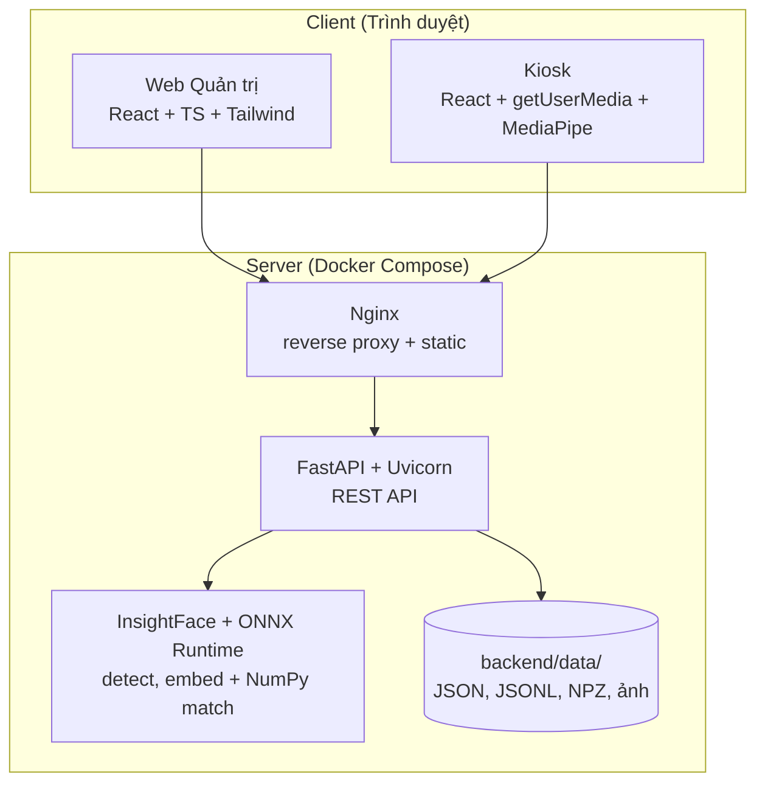

# TECHSTACK: Hệ thống Quản lý Hội viên & Kiểm soát Ra vào bằng Nhận diện Khuôn mặt

> **Phiên bản:** 0.1 (Demo / PoC)
> **Tham chiếu:** `SPEC.md` (mục 5.2 Công nghệ đề xuất)
> **Lưu ý:** Số phiên bản dưới đây là mức **major khuyến nghị**. Khi khởi tạo dự án, hãy ghim (pin) phiên bản chính xác trong `requirements.txt` / `package-lock.json` sau khi kiểm tra bản ổn định mới nhất.

---

## 1. Nguyên tắc lựa chọn

| Nguyên tắc | Ý nghĩa với dự án |
|---|---|
| **Chạy một lệnh** | Toàn bộ hệ thống khởi động bằng `docker compose up` (NFR-07) |
| **Ưu tiên đơn giản** | Ít thành phần nhất có thể; thành phần tùy chọn được đánh dấu rõ |
| **Chạy được trên CPU** | Demo không bắt buộc GPU; GPU chỉ để tăng tốc (NFR-01) |
| **Mã nguồn mở** | Không phụ thuộc dịch vụ trả phí; dữ liệu sinh trắc không rời khỏi hệ thống |
| **Dễ thay thế** | Mỗi tầng có phương án thay thế khi cần đổi |
| **Không dùng CSDL (demo)** | Dữ liệu lưu thành file trong `backend/data/`, truy cập qua lớp repository để sau này đổi sang CSDL |

---

## 2. Tổng quan kiến trúc công nghệ



---

## 3. Chi tiết theo tầng

### 3.1 Frontend (Web quản trị + Kiosk)

| Hạng mục | Lựa chọn | Lý do | Phương án thay thế |
|---|---|---|---|
| Ngôn ngữ | **TypeScript** | Kiểu tĩnh, đồng bộ kiểu với schema API | JavaScript |
| Framework | **React 18** | Hệ sinh thái lớn, phù hợp UI dạng dashboard | Vue 3, Svelte |
| Build tool | **Vite** | Khởi động và HMR nhanh | Next.js (nếu cần SSR) |
| Giao diện | **Tailwind CSS** | Dựng nhanh, nhất quán | CSS Modules |
| Component | **shadcn/ui** (Radix UI) | Truy cập tốt (a11y), tùy biến dễ | Ant Design, MUI |
| Định tuyến | **React Router** | Chuẩn phổ biến | TanStack Router |
| Gọi API & cache | **TanStack Query** | Cache, retry, polling cho log/dashboard | SWR |
| Form & validate | **React Hook Form + Zod** | Validate phía client, tái sử dụng schema | Formik + Yup |
| Biểu đồ | **Recharts** | Biểu đồ lượt vào theo giờ đơn giản | Chart.js |
| Camera | **Web API `getUserMedia`** | Chuẩn trình duyệt, không cần cài thêm | |
| Phát hiện mặt phía client | **MediaPipe Face Detection** | Nhẹ, chạy trong trình duyệt, chỉ gửi khung hình khi có mặt rõ | `face-api.js` |
| Thời gian thực (tùy chọn) | **Polling 3 giây** (mặc định), **WebSocket** (nâng cao) | Polling đủ cho demo | Server-Sent Events |
| Đa ngôn ngữ | **i18next** | Giao diện tiếng Việt, sẵn sàng thêm ngôn ngữ | |

> **Lưu ý:** `getUserMedia` chỉ hoạt động trên `https://` hoặc `localhost`. Khi demo qua mạng LAN cần cấp chứng chỉ (xem mục 6).

### 3.2 Backend (API)

| Hạng mục | Lựa chọn | Lý do | Phương án thay thế |
|---|---|---|---|
| Ngôn ngữ | **Python 3.11+** | Hệ sinh thái AI/ML tốt nhất cho nhận diện khuôn mặt | |
| Framework | **FastAPI** | Async, tự sinh OpenAPI/Swagger, Pydantic tích hợp | Django REST, Flask |
| ASGI server | **Uvicorn** (dev) / **Gunicorn + Uvicorn workers** (chạy thật) | Chuẩn cho FastAPI | Hypercorn |
| Validate | **Pydantic v2** | Schema request/response | |
| Lưu trữ | **Lớp repository tự viết** (JSON/JSONL + `orjson`) | Không cần CSDL; mọi đọc/ghi đi qua `storage/` | TinyDB, SQLite |
| Khóa ghi | **`asyncio.Lock`** + **`filelock`** | Tránh ghi chồng; API chạy 1 worker | |
| Xác thực | **PyJWT** + **argon2-cffi** | JWT access/refresh; băm mật khẩu hiện đại | bcrypt |
| Giới hạn tần suất | **slowapi** | Rate limit cho `/auth/login`, `/access/recognize` | Nginx `limit_req` |
| Upload file | **python-multipart** | Nhận ảnh `multipart/form-data` | |
| Xuất CSV | **csv** (thư viện chuẩn) / **pandas** (nếu cần) | | |
| Tác vụ nền (tùy chọn) | **APScheduler** | Tự động xóa snapshot quá hạn, chuyển trạng thái `expired` theo ngày | Celery + Redis (quá nặng cho demo) |
| Cấu hình | **pydantic-settings** | Đọc biến môi trường (`MATCH_THRESHOLD`, …) | |
| Logging | **structlog** hoặc `logging` chuẩn | Log có cấu trúc, không ghi dữ liệu sinh trắc thô | |

### 3.3 Nhận diện khuôn mặt (Face Service)

| Hạng mục | Lựa chọn | Lý do |
|---|---|---|
| Thư viện chính | **InsightFace** (model pack `buffalo_l`) | Độ chính xác cao, gồm cả phát hiện và nhận dạng |
| Phát hiện mặt | **RetinaFace / SCRFD** (có trong `buffalo_l`) | Cho bounding box và 5 landmarks |
| Trích xuất đặc trưng | **ArcFace** (vector **512 chiều**) | Tiêu chuẩn thực tế cho nhận dạng khuôn mặt |
| Runtime suy luận | **ONNX Runtime** (CPU mặc định; `onnxruntime-gpu` nếu có CUDA) | Nhẹ, không cần PyTorch |
| Xử lý ảnh | **OpenCV (headless)**, **NumPy**, **Pillow** | Giải mã ảnh, resize, đo độ nét/độ sáng |
| Đo độ tương đồng | **Cosine similarity** | Phù hợp với embedding ArcFace |
| Kiểm tra chất lượng | Tự cài đặt: số mặt, kích thước tối thiểu, độ sáng, độ nét (phương sai Laplacian), góc đầu từ landmarks | Đáp ứng FR-F03 |
| Liveness cơ bản | **Chớp mắt / quay đầu** dựa trên landmarks (MediaPipe phía client + kiểm tra phía server) | Giảm giả mạo bằng ảnh tĩnh (FR-A07) |

**Phương án thay thế:**
- `face_recognition` (dlib): cài đặt và dùng đơn giản hơn nhưng độ chính xác thấp hơn và chậm trên CPU.
- `buffalo_s`: model nhẹ hơn khi máy yếu (đổi lấy độ chính xác).
- **Lưu ý giấy phép:** model pack của InsightFace có điều khoản sử dụng riêng (thường giới hạn mục đích phi thương mại). Cần kiểm tra giấy phép trước khi dùng cho sản phẩm thương mại; có thể thay bằng model có giấy phép phù hợp.

### 3.4 Lưu trữ dữ liệu (không dùng CSDL)

Ở giai đoạn demo, toàn bộ dữ liệu lưu trong thư mục `backend/data/` (cấu trúc chi tiết ở `SPEC.md` mục 6).

| Hạng mục | Lựa chọn | Lý do |
|---|---|---|
| Dữ liệu có cấu trúc | **JSON**: mỗi hội viên một file `members/{id}.json`; danh mục trong `plans.json`, `devices.json`, `staff_users.json` | Dễ xem, sửa, xóa bằng tay khi demo |
| Nhật ký ra vào, audit | **JSON Lines** theo ngày/tháng, chỉ ghi nối thêm (append-only) | Ghi nhanh, không phải ghi lại cả file |
| Embedding khuôn mặt | **NumPy `.npz`**, mỗi hội viên một file (N x 512, float32) | Gọn, nạp nhanh vào RAM |
| Tìm kiếm 1:N | **NumPy** (ma trận embedding chuẩn hóa trong RAM, tích vô hướng = cosine) | Với khoảng 1.000 hội viên, kết quả trong vài mili giây, không cần index vector |
| Ảnh avatar, snapshot | Thư mục `avatars/`, `snapshots/YYYY-MM-DD/` | Dọn tự động theo ngày |
| Tuần tự hóa | **`orjson`** | Nhanh hơn `json` chuẩn |
| Ghi an toàn | Ghi file tạm rồi `os.replace` (atomic) | Tránh hỏng file khi bị ngắt giữa chừng |
| Ghi đồng thời | `asyncio.Lock` + `filelock`, **1 worker** Uvicorn | Đơn giản, đủ cho demo |
| Cache | Hồ sơ hội viên và chỉ mục embedding giữ trong RAM (write-through) | Danh sách/tìm kiếm nhanh |

**Phương án thay thế:** SQLite (một file, có truy vấn và giao dịch) hoặc TinyDB nếu muốn truy vấn dễ hơn mà vẫn không cần dịch vụ CSDL.

**Lưu ý:**
- Thêm `backend/data/` vào `.gitignore`: đây là dữ liệu sinh trắc học.
- Chỉ an toàn với một tiến trình API; không có giao dịch nhiều file.
- Nếu cần mã hóa, dùng mã hóa đĩa/volume.

### 3.5 Hạ tầng & triển khai

| Hạng mục | Lựa chọn | Ghi chú |
|---|---|---|
| Container | **Docker** + **Docker Compose** | Services: `web`, `api`; mount `backend/data` làm volume |
| Reverse proxy | **Nginx** (hoặc **Caddy** để tự cấp HTTPS) | Phục vụ frontend tĩnh, proxy `/api` |
| HTTPS cho LAN | **mkcert** (chứng chỉ cục bộ) hoặc **Caddy internal TLS** | Cần để camera hoạt động khi truy cập qua IP LAN |
| Quản lý cấu hình | **`.env`** + `.env.example` | Không commit khóa bí mật |
| Model cache | Volume Docker riêng cho model InsightFace | Tránh tải lại mỗi lần khởi động |

### 3.6 Kiểm thử & chất lượng mã

| Hạng mục | Công cụ | Mục đích |
|---|---|---|
| Unit/Integration backend | **pytest**, **pytest-asyncio**, **httpx** (`AsyncClient`) | Test API, logic quyết định truy cập |
| Test lưu trữ | **`tmp_path`** của pytest | Mỗi test dùng thư mục dữ liệu tạm, không đụng dữ liệu thật |
| Unit frontend | **Vitest** + **React Testing Library** | Component, hook |
| End-to-end | **Playwright** | Luồng đăng ký hội viên → đăng ký mặt → kiosk |
| Mô phỏng nhận diện | `scripts/simulate_access.py` (ảnh tĩnh) | Test không cần camera (NFR-08) |
| Đo độ chính xác | Script tính **TAR/FAR**, chọn ngưỡng | Đáp ứng NFR-02, giai đoạn P5 |
| Lint/format Python | **Ruff**, **Black** (hoặc `ruff format`), **mypy** | Chất lượng và kiểu |
| Lint/format JS/TS | **ESLint**, **Prettier**, `tsc --noEmit` | |
| Git hooks | **pre-commit** | Chạy lint trước khi commit |
| CI (tùy chọn) | **GitHub Actions** | Chạy lint + test mỗi PR |

### 3.7 Tài liệu & công cụ phát triển

| Hạng mục | Công cụ |
|---|---|
| Tài liệu API | **Swagger UI / ReDoc** (FastAPI tự sinh tại `/docs`, `/redoc`) |
| Sơ đồ | **Mermaid** (nhúng trực tiếp trong Markdown) |
| Quản lý phụ thuộc Python | **uv** hoặc **pip + venv** (`requirements.txt`) |
| Quản lý phụ thuộc JS | **pnpm** (hoặc npm) |
| Seed dữ liệu | `scripts/seed.py` (hội viên, gói, thiết bị mẫu) |

---

## 4. Ánh xạ công nghệ với yêu cầu chính

| Yêu cầu (SPEC) | Công nghệ đáp ứng |
|---|---|
| FR-F01, FR-A01: Camera trên trình duyệt | `getUserMedia`, MediaPipe |
| FR-F03: Kiểm tra chất lượng ảnh | OpenCV, landmarks của InsightFace |
| FR-F04, FR-A02: Embedding và so khớp 1:N | InsightFace (ArcFace 512-d), NumPy (cosine, chỉ mục trong RAM) |
| FR-A07: Liveness cơ bản | MediaPipe (client) + kiểm tra landmarks (server) |
| FR-A05: Cooldown / anti-passback | Logic trong `access_service.py`, trạng thái gần nhất trong RAM + log JSONL |
| FR-L03: Dashboard | TanStack Query + Recharts, tổng hợp từ log JSONL |
| FR-L05: Tự xóa snapshot sau N ngày | APScheduler |
| FR-U01–U04: Xác thực, RBAC, API key kiosk | PyJWT, argon2, FastAPI dependencies |
| NFR-01: Độ trễ ≤ 1.5 giây | ONNX Runtime, giảm độ phân giải ảnh (640×480), phát hiện mặt phía client |
| NFR-05: Bảo mật | HTTPS, rate limit, băm mật khẩu và API key |
| NFR-07: Một lệnh khởi động | Docker Compose |
| NFR-08: Test không cần camera | `simulate_access.py`, Playwright (fake media stream) |

---

## 5. Yêu cầu môi trường

### 5.1 Môi trường phát triển

| Thành phần | Tối thiểu | Khuyến nghị |
|---|---|---|
| CPU | 4 nhân | 8 nhân |
| RAM | 8 GB | 16 GB |
| GPU | Không bắt buộc | NVIDIA có CUDA (giảm độ trễ nhận diện xuống ≤ 500 ms) |
| Ổ đĩa trống | 5 GB (image Docker + model) | 10 GB |
| HĐH | Linux, macOS, Windows (WSL2) | Linux/macOS |
| Phần mềm | Docker, Docker Compose | + Node.js LTS, Python 3.11 để chạy ngoài container |
| Thiết bị | Webcam 720p | Webcam có tự động lấy nét, đặt nơi đủ sáng |

### 5.2 Máy kiosk (demo)

- Trình duyệt hiện đại (Chrome/Edge/Firefox bản mới) chạy chế độ toàn màn hình (kiosk mode).
- Webcam đặt ngang tầm mắt, ánh sáng đều, tránh ngược sáng.
- Kết nối mạng ổn định tới máy chủ API.

---

## 6. Cấu trúc dịch vụ Docker Compose

| Service | Image / Build | Cổng | Vai trò |
|---|---|---|---|
| `web` | Build từ `frontend/` (Nginx phục vụ bản build) | 80/443 | Giao diện quản trị + kiosk, proxy `/api` |
| `api` | Build từ `backend/` (Python 3.11-slim) | 8000 (nội bộ) | FastAPI + Face Service + lưu trữ file (1 worker) |

**Volumes:** `./backend/data` (toàn bộ dữ liệu), `models` (cache model InsightFace).

---

## 7. Phụ thuộc chính

### 7.1 Backend (`requirements.txt`, rút gọn)

```
fastapi
uvicorn[standard]
pydantic
pydantic-settings
orjson
filelock
pyjwt
argon2-cffi
python-multipart
slowapi
apscheduler
insightface
onnxruntime          # hoặc onnxruntime-gpu
opencv-python-headless
numpy
pillow
pytest
pytest-asyncio
httpx
ruff
mypy
```

### 7.2 Frontend (`package.json`, rút gọn)

```
react, react-dom, react-router-dom
typescript, vite
tailwindcss
@radix-ui/* (qua shadcn/ui)
@tanstack/react-query
react-hook-form, zod, @hookform/resolvers
recharts
i18next, react-i18next
@mediapipe/tasks-vision
vitest, @testing-library/react
@playwright/test
eslint, prettier
```

---

## 8. Quyết định kiến trúc quan trọng (ADR rút gọn)

| # | Quyết định | Lý do | Đánh đổi |
|---|---|---|---|
| ADR-1 | **Lưu trữ bằng file** trong `backend/data/` thay vì CSDL; so khớp bằng NumPy trong RAM | Demo: không cần cài/vận hành DB; dữ liệu xem và xóa trực tiếp được | Không an toàn khi nhiều tiến trình; không có giao dịch/truy vấn; phù hợp ≤ vài nghìn hội viên |
| ADR-2 | Nhận diện chạy **phía server** (InsightFace), phát hiện mặt sơ bộ phía client | Dữ liệu embedding và quyết định tập trung, dễ kiểm soát bảo mật | Tốn băng thông gửi ảnh; giảm bằng độ phân giải thấp |
| ADR-3 | **Không lưu ảnh gốc** khi đăng ký, chỉ lưu embedding | Tối thiểu hóa dữ liệu sinh trắc | Không thể tính lại embedding khi đổi model; phải đăng ký lại |
| ADR-4 | **REST + polling** thay vì WebSocket cho dashboard | Đơn giản, đủ cho demo | Độ trễ cập nhật tối đa ~3 giây |
| ADR-5 | **FastAPI đồng bộ-trong-async**: chạy suy luận nặng trong thread pool (`run_in_executor`) | Không chặn event loop | Cần giới hạn số suy luận đồng thời |
| ADR-6 | Chạy **CPU mặc định**, GPU tùy chọn | Mọi máy đều demo được | Độ trễ cao hơn trên CPU yếu |

---

## 9. Lộ trình nâng cấp công nghệ (sau demo)

| Nhu cầu | Hướng nâng cấp |
|---|---|
| Nhiều hội viên, truy cập đồng thời | Chuyển sang PostgreSQL 16 + pgvector, giữ nguyên interface repository |
| Nhiều cửa, nhiều chi nhánh | Tách Face Service thành dịch vụ riêng, hàng đợi (Redis/RabbitMQ) |
| Nhiều hội viên (> 100.000) | Qdrant/Milvus hoặc index ANN chuyên dụng |
| Chống giả mạo mạnh | Camera IR/độ sâu, model passive anti-spoofing |
| Điều khiển khóa cửa thật | Raspberry Pi/ESP32 + relay, giao tiếp MQTT |
| Nhận diện tại thiết bị (edge) | ONNX/TensorRT trên Jetson, đồng bộ embedding về máy chủ |
| Giám sát vận hành | Prometheus + Grafana, Sentry cho lỗi |
| Cập nhật thời gian thực | WebSocket/SSE thay polling |
| Bảo mật nâng cao | Quản lý bí mật (Vault), mã hóa embedding ở cấp ứng dụng, SSO cho nhân viên |
